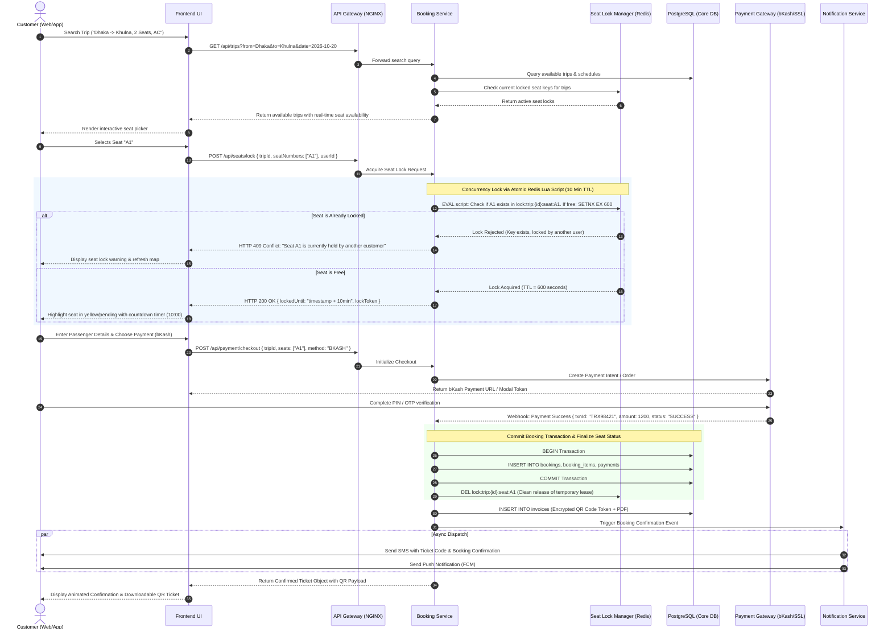

# Bookify: Technical Sequence Flows & Concurrency Model

> **Reference Diagram**: [Technical Sequence Diagram](file:///d:/VS%20Code/agency/websites%20bussine/Bookify/.agent/diagrams/technical-sequence-diagram.jpg) (Slide 14 / `image14.jpg` from `bookify_slider_plan.pptx`).

---

## Flow 1: Standard Seat Selection & Real-Time Redis Locking



---

## Flow 2: AI-Driven Schedule Optimization & Vendor Response

```mermaid
sequenceDiagram
    autonumber
    participant DB as PostgreSQL / BigQuery
    participant AI as AI Engine (FastAPI)
    participant Redis as Redis Stream Queue
    actor Vendor as Vendor / Bus Operator
    participant VS as Fleet & Vendor Service

    Note over AI,DB: Continuous Telemetry Monitoring Loop
    AI->>DB: Fetch historical trip occupancy, delays, weather, festival dates
    AI->>AI: Run Prophet / XGBoost Demand Forecast Model
    AI->>AI: Evaluate Fleet Schedule Efficiency
    
    alt Schedule Inefficiency Detected
        Note over AI: E.g., 10:00 PM Trip has 32% occupancy; 01:00 PM has 135% demand spike
        AI->>Redis: Enqueue Optimization Recommendation { vendorId, route: "Dhaka->Cox", shiftTo: "13:00", projectedGain: "+18%" }
        Redis->>VS: Dispatch AI Recommendation Record to Vendor Dashboard
        VS->>Vendor: Alert: "AI Advisor: Move Bus from 10 PM to 1 PM next Friday to gain +18% revenue"
        
        alt Vendor Approves Recommendation
            Vendor->>VS: POST /api/vendor/recommendations/{id}/approve
            VS->>DB: UPDATE trip_schedules SET departure_time = '13:00:00' WHERE id = ...
            VS->>DB: UPDATE ai_recommendations SET status = 'APPROVED'
            VS-->>Vendor: Schedule updated successfully! New slots published to Search.
        else Vendor Rejects Recommendation
            Vendor->>VS: POST /api/vendor/recommendations/{id}/reject { reason: "Driver maintenance" }
            VS->>DB: UPDATE ai_recommendations SET status = 'REJECTED'
            VS->>AI: Log feedback into AI training buffer for reinforcement tuning
        end
    end
```

